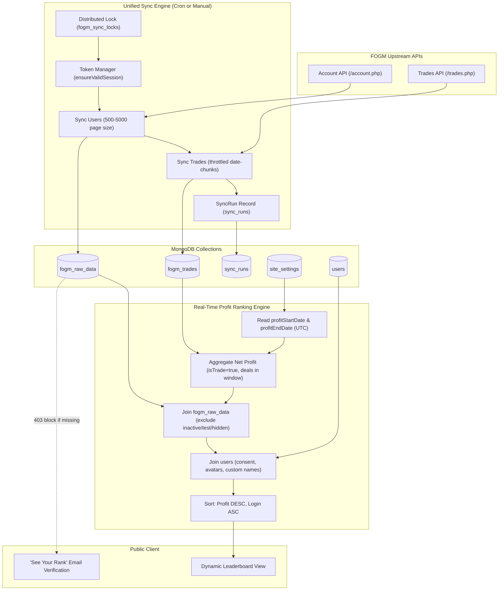

# FOGM Trading Leaderboard - Codebase Simplification Report
> **Superseded (13 Nov 2026):** the Settings ranking-date window described below was removed. The ranking period is now the competition start/end; see `docs/COMPETITION.md` → "Ranking period".


This document records the complete architectural simplification of the FOGM trading platform, transitioning the system from a multi-competition, participant-enrollment, and winner-declaration model to a single, unified, real-time trading leaderboard powered by FOGM trade profit calculations.

---

## 1. Architecture Overview (Before vs. After)

### Before Simplification
* **Multi-Competition Model**: Multiple competitions existed simultaneously (`competitions` collection), requiring complex lifecycles (`upcoming`, `registration_open`, `active`, `ended`, `winners_declared`).
* **Participant Tracking**: Required enrollment (`competition_participants` collection) before users could qualify, mapping specific MT logins to specific competition IDs with starting balances and snapshots.
* **Cached / Stored Snapshots**: Ranks were periodically frozen and written to MongoDB (`leaderboard_snapshots` collection) with prize tier allocations and final winner statuses.
* **Dual Sync Jobs**: Separate, uncoordinated endpoints for FOGM user sync and FOGM trades sync, using distinct sync models (`fogm_sync_runs` and `fogm_trade_syncs`).
* **Bloated Admin Panel**: Nine admin sections including CRM database users, competitions management, recalculation triggers, and OpenAPI specs.

### After Simplification
* **Single Unified Leaderboard**: Exactly one global leaderboard ranking traders by net profit calculated directly from closed trades (`fogm_trades`) within an inclusive UTC profit window (`profitStartDate` to `profitEndDate` configured in Settings).
* **On-Demand Rank Calculation**: Ranks are dynamically calculated from synced data on page load. No rank snapshots, winner statuses, or prize allocations are stored in the database.
* **Zero Competition Footprint**: All competition models, participants, winners, prizes, and snapshot engines are completely deleted.
* **Direct FOGM Account Validation**: When a user clicks "See your rank", their email is verified directly against synced FOGM trading accounts (`fogm_raw_data`). Non-FOGM emails are blocked immediately before sending an OTP and re-verified on token issuance.
* **Unified Sync Engine**: A single atomic sync runner (`runUnifiedSync`) that enforces a distributed lock, checks token validity, logs in to FOGM if expired, syncs users with page size clamping (500–5000), fetches trades with 250ms throttling and deal deduplication, and records history in a unified `sync_runs` collection.
* **Streamlined Admin Panel**: Exactly six core administrative pages:
  1. **Dashboard** (`/admin`)
  2. **FOGM Users** (`/admin/leaderboard`)
  3. **FOGM Trades** (`/admin/trades`)
  4. **Settings** (`/admin/settings`)
  5. **Sync Status** (`/admin/sync`)
  6. **Audit Log** (`/admin/audit`)



---

## 2. Deleted Files

The following files were removed as part of the simplification plan:

| File Path | Description / Reason for Deletion |
|---|---|
| `app/admin/competitions/page.tsx` | Legacy competition admin CRUD page. |
| `app/admin/users/page.tsx` | Legacy database CRM user management page. |
| `app/admin/api-docs/page.tsx` | Legacy OpenAPI browser page. |
| `app/api/admin/competitions/route.ts` | List and create competitions endpoint. |
| `app/api/admin/competitions/[id]/route.ts` | Competition update and delete endpoint. |
| `app/api/admin/competitions/[id]/export/route.ts` | Competition participant export endpoint. |
| `app/api/admin/competitions/[id]/finalize/route.ts` | Competition winner declaration endpoint. |
| `app/api/admin/competitions/[id]/participants/route.ts` | Manual participant enrollment endpoint. |
| `app/api/admin/competitions/[id]/recalculate/route.ts` | Manual competition rank freeze endpoint. |
| `app/api/admin/competitions/[id]/reconcile/route.ts` | Competition trade reconciliation endpoint. |
| `app/api/admin/users/route.ts` | CRM user list endpoint. |
| `app/api/admin/users/bulk/route.ts` | CRM bulk user action endpoint. |
| `app/api/admin/users/export/route.ts` | CRM user CSV export endpoint. |
| `app/api/admin/fogm/sync/route.ts` | Obsolete separate account-only sync endpoint. |
| `app/api/competitions/route.ts` | Public competitions list endpoint. |
| `app/api/competitions/[slug]/route.ts` | Public competition detail endpoint. |
| `app/api/competitions/[slug]/join/route.ts` | Public competition participant join endpoint. |
| `app/api/internal/competitions-recompute/route.ts` | Legacy recurring competition recomputation cron endpoint. |
| `components/CompetitionSection.tsx` | Competition announcement & countdown banner component. |
| `lib/competition-routes.ts` | Decoupled and deleted (auth helpers moved to `lib/admin-auth.ts`). |
| `lib/fogm/competition-service.ts` | Competition snapshot computation and enrollment service. |
| `lib/api-registry.ts` | Legacy API registry documentation helper. |
| `docs/COMPETITION_CHANGES.md` | Legacy documentation from prior multi-competition feature. |
| `lib/models/Competition.ts` | Mongoose model for competitions. |
| `lib/models/CompetitionParticipant.ts` | Mongoose model for competition participants. |
| `lib/models/LeaderboardSnapshot.ts` | Mongoose model for frozen leaderboard snapshots. |
| `lib/models/FogmTradeSync.ts` | Obsolete sync state model replaced by `SyncRun`. |

---

## 3. Modified Files

| File Path | Changes Made & Rationale |
|---|---|
| `components/admin/AdminShell.tsx` | Pruned navigation to exactly 6 allowed admin pages (Dashboard, FOGM Users, FOGM Trades, Settings, Sync Status, Audit Log). |
| `lib/admin-auth.ts` | Extracted `adminOr401()`, `isId()`, `zodMessage()`, `errorResponse()` from legacy competition helpers into a clean, reusable admin authentication library. |
| `lib/models/SiteSettings.ts` | Added `profitStartDate`, `profitEndDate`, `syncIntervalMinutes` (1–1440), and `syncPageSize` (500–5000). Leniently pruned prize tiers, rules, and winner declaration fields from schema while gracefully tolerating legacy Mongo document fields. |
| `lib/defaults.ts` & `lib/settings.ts` | Added default settings for `syncIntervalMinutes` (10), `syncPageSize` (500), and UTC profit window fields. Safely wrapped `cacheTag("settings")` in `try-catch` for non-cacheComponent test runners. |
| `lib/models/FogmTrade.ts` | Added compound index `{ isTrade: 1, timeUtc: 1, login: 1 }` for high-throughput profit aggregation queries. |
| `scripts/init-fogm-indexes.ts` | Removed competition index calls; added `{ isTrade: 1, timeUtc: 1, login: 1 }` on `fogm_trades` and `{ startedAt: -1 }`, `{ status: 1 }` on `sync_runs`. |
| `lib/fogm/fetcher.ts` | Updated account fetcher to accept dynamic clamped `pageSize` (500–5000) from settings. |
| `lib/fogm/trades-client.ts` | Updated `fetchDealsByRange` and `fetchDealsForLogin` to support dynamic `pageSize` (500–5000) and request throttling. |
| `lib/fogm/trade-store.ts` | Pruned legacy `FogmTradeSync` ingestion runner and status helpers; retained pure `dealToDoc`, `docToDeal`, `upsertDeals`, and `loadDeals` routines used by the unified sync engine. |
| `lib/fogm/scheduler.ts` | Simplified background scheduler to read `syncIntervalMinutes` on each tick and call `runUnifiedSync("cron")`. Removed all competition recalculation logic. |
| `app/api/internal/fogm-sync/route.ts` | Updated internal cron webhook to invoke `runUnifiedSync("cron")` and map response codes (200 OK, 207 Partial, 409 Locked, 500 Error). |
| `app/api/admin/settings/route.ts` | Added validation for profit start and end dates (`startDate <= endDate`), `syncIntervalMinutes`, `syncPageSize`, and audit logging (`settings.update`). |
| `app/admin/settings/page.tsx` | Rewrote admin Settings UI: configured profit calculation window dates, sync interval & page size controls, brand identity, and maintenance mode. Zero prize/competition inputs. |
| `app/api/admin/stats/route.ts` | Updated stats route to query `FogmRawData` for trader counts, `FogmTrade` for trade volume, and `SyncRun` for last sync timestamps. |
| `app/admin/page.tsx` (Dashboard) | Rewrote admin Dashboard with 4 high-level stat tiles (Total Accounts, Total Trades, Profit Window, Last Sync), unified "Sync Now" trigger button, recent sync history table, and audit trail preview. |
| `app/admin/leaderboard/page.tsx` | Updated FOGM Users admin page: switched manual sync button to trigger `POST /api/admin/sync`. |
| `app/admin/trades/page.tsx` | Updated FOGM Trades admin page: switched manual sync button to trigger `POST /api/admin/sync`. |
| `app/api/auth/request-otp/route.ts` | Added verification against `FogmRawData`. Unknown emails receive 403 `not_in_fogm` and no OTP code is generated or sent. |
| `app/api/auth/verify-otp/route.ts` | Added defense-in-depth re-verification against `FogmRawData` during code redemption. |
| `components/JoinModal.tsx` | Updated error messaging to clearly inform un-synced traders, updated branding to "Trading Leaderboard". |
| `lib/fogm/leaderboard-service.ts` | Rewrote to delegate directly to `calculateProfitRankings()`. Removed competition imports and snapshot models. |
| `components/LandingClient.tsx` | Updated public landing page: removed `CompetitionSection`, `WinnersSection`, `PrizesSection`; added profit window banner (`profitStartDate` to `profitEndDate` UTC); updated table columns to Rank, Trader, Trades, Equity, Profit (USD); updated Top3Card and overview metrics. |
| `components/ShareCard.tsx` & `app/api/card/[userId]/route.tsx` | Updated share card to display "Trading Leaderboard" and trader's actual closed trade count. |
| `app/u/[userId]/page.tsx` | Updated metadata title to "Trading Leaderboard". |
| `lib/api.ts` | Updated `LeaderboardPage` interface to include `configured` and `window` objects matching dynamic ranking output. |
| `__tests__/live-fixes.test.ts` | Expanded technical admin allowlist regexes for legitimate administrative labels. |

---

## 4. New Files

| File Path | Description / Purpose |
|---|---|
| `lib/models/SyncRun.ts` | Mongoose schema and model for collection `sync_runs`. Records `runId`, `trigger` (`cron` \| `manual`), `startedAt`, `completedAt`, `durationMs`, `status` (`running` \| `completed` \| `failed` \| `partial`), `usersFetched`, `usersUpserted`, `tradesFetched`, `tradesInserted`, `tradesUpdated`, `errorMessage`, `errorCode`. Indexed on `{ startedAt: -1 }` and `{ status: 1 }`. |
| `lib/fogm/token-manager.ts` | Centralized FOGM session lifecycle manager. Exports `ensureValidSession()`, `isSessionExpired()`, `reloginNow()`, and `getTokenStatus()`. Enforces distributed locking so concurrent calls never double-login. |
| `lib/fogm/unified-sync.ts` | Core unified sync engine (`runUnifiedSync`). Coordinates the complete sync sequence: lock acquisition $\to$ session validation $\to$ account sync with page size clamping $\to$ global trade sync with date-chunking & throttling $\to$ `SyncRun` finalization $\to$ lock release. |
| `app/api/admin/sync/route.ts` | Admin API route for sync management. `GET` returns paginated run history, last success, current run status, and next scheduled tick. `POST` triggers an on-demand manual sync with audit log entry `sync.manual`. |
| `app/admin/sync/page.tsx` | Dedicated Sync Status monitoring page in the admin console. Displays real-time sync metrics, trigger badges, API row counts, duration, error details, and an interactive "Sync Now" button. |
| `lib/fogm/profit-ranking.ts` | High-performance dynamic ranking engine (`calculateProfitRankings`). Queries settings for UTC profit window, aggregates `fogm_trades` net profit, joins eligible `fogm_raw_data` accounts, incorporates user display consents/avatars, breaks ties deterministically, and assigns 1-based ranks. |
| `scripts/drop-legacy-collections.ts` | Safe migration CLI script that inspects legacy collections, prints document counts, and drops them only when explicitly passed the `--confirm` flag. |
| `__tests__/unified-sync.test.ts` | Unit tests for unified sync page-size clamping (500–5000), token re-auth sequence, partial failure status assignment, and lock contention handling. |
| `__tests__/profit.test.ts` | Unit tests for profit window UTC boundary parsing, 0-trade account profit calculations, deterministic tie-breaking, inactive/test account exclusion, and public consent compliance. |
| `__tests__/otp-flow.test.ts` | Unit tests verifying that unknown emails are rejected with 403 `not_in_fogm` with zero OTP documents created, and existing FOGM accounts proceed normally. |

---

## 5. Database Schema & Migration Strategy

### Final State Collections
The following MongoDB collections constitute the operational database in the final architecture:

| Collection Name | Mongoose Model | Purpose |
|---|---|---|
| `users` | `User` | User profiles, notification settings, avatars, and display consent. |
| `fogm_raw_data` | `FogmRawData` | Synced FOGM MT accounts (logins, equity, balance, group, active status). |
| `fogm_trades` | `FogmTrade` | Synced MT trade records (deal, login, symbol, volume, net profit, timeUtc). |
| `sync_runs` | `SyncRun` | Unified audit log of all cron and manual sync executions. |
| `site_settings` | `SiteSettings` | Global configuration (profit window, sync interval/page size, brand). |
| `audit_logs` | `AuditLog` | Administrative action trail (settings updates, manual syncs). |
| `otp_codes` | `OtpCode` | Ephemeral OTP storage for email verification. |
| `rate_limits` | `RateLimit` | IP and email rate limiting buckets. |
| `fogm_sessions` | `FogmSession` | Encrypted FOGM upstream session cookies and token validity. |
| `fogm_sync_locks` | `FogmSyncLock` | Distributed lock documents preventing concurrent sync execution. |
| `fogm_health` | `FogmHealth` | Upstream API reachability and latency diagnostics. |
| `fogm_raw_snapshots` | `FogmRawSnapshot` | 90-day TTL snapshots of raw account sync payloads for auditing. |

### Protected Collections
The following collections are hardcoded as protected and **cannot be dropped**:
`users`, `fogm_raw_data`, `fogm_trades`, `otp_codes`, `rate_limits`, `audit_logs`, `fogm_sessions`, `fogm_sync_locks`, `fogm_health`, `sync_runs`, `site_settings`, `fogm_raw_snapshots`.

### Legacy Collections (Pending Drop via Script)
* `competitions`
* `competition_participants`
* `leaderboard_snapshots`
* `fogm_trade_syncs`
* `fogm_sync_runs`

> [!IMPORTANT]
> Legacy collections are **not automatically dropped** during deployments to prevent unintended data loss. To drop legacy collections in staging or production environments, run:
> ```bash
> npx tsx scripts/drop-legacy-collections.ts --confirm
> ```
> Without `--confirm`, the script executes a dry run, printing existing document counts.

### Database Indexes Added
1. **`fogm_trades` Compound Index**:
   ```typescript
   { isTrade: 1, timeUtc: 1, login: 1 }
   ```
   Ensures sub-second aggregation when filtering trading deals by the inclusive UTC date window and grouping net profit by login.
2. **`sync_runs` Compound & Status Indexes**:
   ```typescript
   { startedAt: -1 }
   { status: 1 }
   ```
   Optimizes admin dashboard sync history queries and active running job lookups.

---

## 6. Site Settings Reference

The `site_settings` collection (`lib/models/SiteSettings.ts`) controls runtime behavior without requiring code deployments:

| Field Name | Type | Default | Validation & Clamping | Purpose / Notes |
|---|---|---|---|---|
| `profitStartDate` | `string \| null` | `null` | `YYYY-MM-DD` or empty | Inclusive start date for closed trade profit aggregation (evaluated at 00:00:00.000Z). |
| `profitEndDate` | `string \| null` | `null` | `YYYY-MM-DD` or empty | Inclusive end date for closed trade profit aggregation (evaluated at 23:59:59.999Z). Validated on save: `startDate <= endDate`. |
| `syncIntervalMinutes` | `number` | `10` | Integer, min `1`, max `1440` | Frequency in minutes between automated background cron sync passes. |
| `syncPageSize` | `number` | `500` | Integer, min `500`, max `5000` | Target batch size per API call when fetching users and trades. Clamped server-side. |
| `brand.name` | `string` | `"Trading Pips"` | String | Public title displayed in navigation and headers. |
| `brand.tagline` | `string` | `"Trade smart. Climb the Board!"` | String | Public subtitle displayed on landing hero. |
| `maintenance.enabled`| `boolean` | `false` | Boolean | When enabled, public users see a maintenance screen. Admin routes remain accessible. |
| `maintenance.message`| `string` | `""` | String | Custom explanation displayed during maintenance. |

---

## 7. Sync Engine & Cron Architecture

### Execution Order
Every sync run (`runUnifiedSync` in `lib/fogm/unified-sync.ts`) executes strictly in this sequence:
1. **Acquire Distributed Lock**: Attempts an atomic `findOneAndUpdate` on `FogmSyncLock`. If a lock exists and has not timed out, the run exits immediately with status `skipped` and code `LOCK_HELD`.
2. **Initialize Run Record**: Writes a document to `sync_runs` with status `running` and timestamp.
3. **Session Validation & Auto-Reauth**: Invokes `ensureValidSession()`. Checks stored `FogmSession`. If missing or within 5 minutes of expiry, it logs in via upstream `/login.php`, stores the encrypted cookie, and refreshes session health.
4. **Sync Users (Account API)**:
   - Queries `SiteSettings` for `syncPageSize` (clamped between 500 and 5000).
   - Fetches accounts from `/account.php` using the authenticated cookie.
   - Upserts into `fogm_raw_data` with change revision detection (`rowHash`).
   - Flags missing accounts as inactive.
5. **Sync Trades (Trades API)**:
   - Queries `/trades.php` using global broker date bounds.
   - Applies the date-splitting chunk strategy: if a daily chunk returns a full page (`limit` reached), it recursively splits into smaller windows down to single days, then queries by individual active logins.
   - Respects 250ms inter-request throttling to protect upstream services.
   - Deduplicates deals by unique `deal` id.
   - Upserts into `fogm_trades`.
6. **Finalize Run Record**:
   - Calculates `durationMs`.
   - If users succeeded but trades encountered an error, marks status as `partial`.
   - If both succeeded, marks status as `completed`.
   - On unhandled exception, marks status as `failed` with redacted error message and code.
7. **Release Distributed Lock**: Guaranteed via `finally` block to prevent deadlock.

---

## 8. Profit Ranking Engine

Implemented in `lib/fogm/profit-ranking.ts` and called dynamically by `/api/leaderboard`:

1. **Inclusive UTC Window**:
   - `profitStartDate` `2026-03-01` $\to$ `2026-03-01T00:00:00.000Z`
   - `profitEndDate` `2026-03-31` $\to$ `2026-03-31T23:59:59.999Z`
2. **Trade Aggregation**:
   - Matches deals where `isTrade: true` and `timeUtc >= startUtc && timeUtc <= endUtc`.
   - Sums `net` (`profit + storage + commission`) grouped by MT `login`.
3. **Zero-Trade Accounts Included**:
   - All active, non-hidden, non-test accounts from `fogm_raw_data` are included in the standings.
   - Accounts with zero trades in the configured window are assigned `$0.00` net profit and 0 trades.
4. **Deterministic Tie-Breaking**:
   - Primary Sort: `netProfit DESC` (higher profit ranks higher).
   - Secondary Sort: `login ASC` (lower MT login number breaks ties deterministically).
5. **PII Stripping & Privacy Consents**:
   - Joins MongoDB `users` by email.
   - If the user has not consented (`showName: false`), displays `"Anonymous trader"`.
   - If `showPhoto: false`, suppresses avatar URL.
   - Completely omits raw email addresses, full logins, and private balances from public leaderboard responses.
6. **Dynamic Recalculation**:
   - Calculated fresh on every request; no stale ranks or static snapshots are stored in the database.

---

## 9. Public Auth & Avatar Flow

1. **Pre-OTP Email Verification**:
   - User enters email in the "See your rank" modal.
   - `POST /api/auth/request-otp` normalizes the email (`toLowerCase().trim()`) and checks if it exists in `fogm_raw_data`.
   - **If not found**: Returns HTTP 403 with `{ ok: false, error: "not_in_fogm" }`. Zero OTP codes are generated in the database, and no email is sent.
   - **If found**: Generates a 6-digit OTP in `otp_codes` and dispatches verification email.
2. **Two-Stage Defense-in-Depth Verification**:
   - User submits code to `POST /api/auth/verify-otp`.
   - Validates code and expiration.
   - Re-verifies against `fogm_raw_data` before creating or updating the session. If missing, returns 403 `not_in_fogm`.
3. **Avatar Upload & Public Visibility**:
   - Verified user can upload a custom avatar (`/api/avatar/sign`).
   - User controls display preferences (`showName`, `showPhoto`).
   - Updated avatars immediately appear on the live leaderboard beside the trader's ranked row.

---

## 10. Verification & Test Results

### 1. TypeScript Static Type Check
Executed `npx tsc --noEmit`:
```
Exit code: 0
Errors: 0
```

### 2. Node.js Test Suite
Executed `pnpm test` (`tsx --test __tests__/**/*.test.ts`):
```
ℹ tests 124
ℹ suites 0
ℹ pass 124
ℹ fail 0
ℹ cancelled 0
ℹ skipped 0
ℹ todo 0
ℹ duration_ms 11616.6313
```
Key coverage areas verified:
* Request OTP FOGM email gating (403 block vs. valid generation).
* Verify OTP re-verification defense in depth.
* Inclusive UTC profit window calculation and 0-trade account handling.
* Deterministic tie-breaking by profit desc, then login asc.
* Page size clamping (500–5000) and token expiry order in unified sync.
* Upstream auth detection, token manager locks, and session expiration.
* PII suppression on public leaderboard routes.

### 3. Production Build
Executed `pnpm build` (`next build` with Turbopack and Cache Components enabled):
```
▲ Next.js 16.4.3 (Turbopack)
✓ Compiled successfully in 11.4s
  Running TypeScript ...
  Finished TypeScript in 10.4s ...
✓ Generating static pages using 15 workers (37/37) in 2.0s
  Finalizing page optimization ...

Route (app)                          Revalidate  Expire
┌ ○ /                                       15m      1y
├ ○ /_not-found
├ ◐ /admin
├ ◐ /admin/audit
├ ◐ /admin/leaderboard
├ ◐ /admin/login
├ ◐ /admin/settings
├ ◐ /admin/sync
├ ◐ /admin/trades
├ ƒ /api/admin/audit
├ ƒ /api/admin/audit/export
├ ƒ /api/admin/fogm/accounts
├ ƒ /api/admin/fogm/accounts/export
├ ƒ /api/admin/fogm/relogin
├ ƒ /api/admin/fogm/status
├ ƒ /api/admin/login
├ ƒ /api/admin/logout
├ ƒ /api/admin/settings
├ ƒ /api/admin/settings/revalidate
├ ƒ /api/admin/stats
├ ƒ /api/admin/sync
├ ƒ /api/admin/test-email
├ ƒ /api/admin/traders
├ ƒ /api/admin/trades
├ ƒ /api/admin/trades/stored
├ ƒ /api/auth/logout
├ ƒ /api/auth/request-otp
├ ƒ /api/auth/verify-otp
├ ƒ /api/avatar/sign
├ ƒ /api/card/[userId]
├ ƒ /api/internal/fogm-sync
├ ƒ /api/leaderboard
├ ƒ /api/me
├ ƒ /api/stats
├ ○ /robots.txt
└ ◐ /u/[userId]
```
All routes compiled and optimized cleanly with zero warnings or errors.
